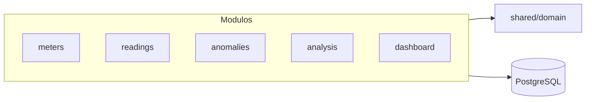
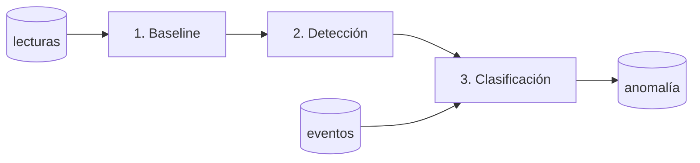

# Arquitectura del Backend

Cómo está organizado el código y cómo funciona el análisis. Para levantar el proyecto y la API, ver el [README](../README.md).

## Stack

| Capa | Tecnología |
|---|---|
| Runtime | Bun |
| Framework | Express 5 |
| Base de datos | PostgreSQL 16 |
| ORM | Prisma 7 |
| IA | API compatible con OpenAI (`AI_API_KEY`, `AI_BASE_URL`, `AI_MODEL`) |
| Validación | zod 4 |
| Testing | `bun test` |
| Lint | ESLint (`bun run lint`) |

## Convención de capas

Cada módulo de `src/modules/<mod>/` tiene la misma estructura, una responsabilidad por archivo:

| Archivo | Qué contiene |
|---|---|
| `*.domain.ts` | Types e interfaces del dominio |
| `*.model.ts` | Schemas zod de validación de entrada |
| `*.service.ts` | Lógica de negocio (orquesta) |
| `*.repository.ts` | Acceso a la base de datos (Prisma) |
| `*.routes.ts` | HTTP: valida la entrada y llama al service |
| `test/` | Tests del módulo |

Lo que comparten varios módulos vive en `src/shared/domain/`.

## Por qué esta arquitectura

**Arquitectura modular fue la justa para este problema.** No hizo falta ni clean architecture ni DDD completos:

- **Modular**: módulos por feature (`meters`, `readings`, `anomalies`, `analysis`, `dashboard`) con una responsabilidad por archivo y fronteras claras. Suficiente para testabilidad, evolución y razonar sobre cada dominio sin pagar el costo de patrones pesados.
- **Clean architecture completa no es necesaria**: su objetivo es aislar el dominio de la infraestructura con capas y puertos/adaptadores. Aquí la persistencia ya queda aislada en `*.repository.ts` y la IA es inyectable (`LlmClient`); añadir más anillos (use cases, adapters, interfaces por capa) sería ceremonia para un dominio de 9 endpoints.
- **DDD completo no es necesario**: los módulos ya funcionan como *bounded contexts* ligeros (types puros en `*.domain.ts`, reglas de negocio en el dominio). Los rituales DDD (aggregates, domain events, lenguaje ubicuo formal) no aportan a este tamaño.

Regla: si el dominio crece (nuevos contextos, más integraciones, equipos), se migra por partes — no se anticipa la ceremonia.

## Pipeline de análisis

Un análisis recorre 3 etapas:

1. **Baseline** — calcula la media y desviación de los primeros 7 días, por medidor.
2. **Detección** — busca señales en los datos: picos bruscos, cambios sostenidos de consumo, o datos eléctricos incoherentes.
3. **Clasificación** — cruza lo detectado con los eventos del medidor (mantenimiento, cambios operativos, etc.) y decide el tipo de anomalía.

### Qué es determinista (reglas, sin IA)

- El baseline, la detección de señales y la consolidación (una anomalía por medidor).
- La clasificación por eventos: un mantenimiento programado convierte la señal en falso positivo, un cambio operativo la explica, etc.
- Los casos que las reglas no pueden decidir se marcan como ambiguos.

### Qué hace la IA

- **Desempata** los casos ambiguos que las reglas no pueden decidir.
- **Explica** cada anomalía confirmada en español: qué pasó y qué hacer, citando la evidencia (baseline vs reciente, por variable).

## Errores

| Status | Código | Condición |
|---|---|---|
| 400 | `VALIDATION_ERROR` | Entrada inválida |
| 404 | `NOT_FOUND` | Recurso inexistente |
| 409 | `ANALYSIS_IN_PROGRESS` | Ya hay un análisis en curso |
| 409 | `INVALID_STATUS_TRANSITION` | Transición de estado ilegal |
| 503 | `AI_NOT_CONFIGURED` | Faltan las variables `AI_*` |
| 500 | `INTERNAL_ERROR` | Error no manejado |

## Documentación

La API se documenta con una spec OpenAPI en `docs/openapi.yaml`, servida por Scalar en `http://localhost:3000/docs` (spec cruda en `/openapi.yaml`).